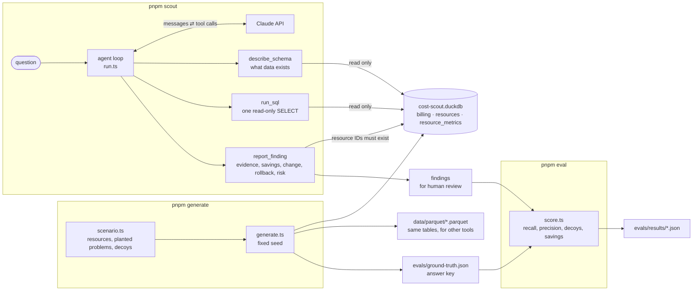

# cost-scout

An agent that analyzes cloud billing data, finds cost waste, and proposes fixes, each with evidence, a rollback plan, and a risk level. It **never changes anything**. It can look and propose; a human approves and executes.

See [PLAN.md](PLAN.md) for scope, status, eval targets, and design decisions.

## How it works



`pnpm generate` builds the dataset and the answer key from one deterministic scenario. `pnpm scout` runs the agent: Claude decides which tools to call, and every tool reads the database without changing it. `pnpm eval` runs the agent several times and scores its findings against the answer key, which the agent never sees.

**Data.** Three tables in DuckDB (also exported as Parquet):

| Table              | What it is                                                                                                                                                                              |
| ------------------ | --------------------------------------------------------------------------------------------------------------------------------------------------------------------------------------- |
| `billing`          | Daily cost and usage using a subset of [FOCUS 1.4](https://focus.finops.org/focus-specification/) columns, the FinOps Foundation's open billing standard that covers both AWS and Azure |
| `resources`        | Inventory: configuration and tags for every resource                                                                                                                                    |
| `resource_metrics` | Daily utilization (CPU, network, IOPS, Lambda memory), like CloudWatch or Azure Monitor                                                                                                 |

Billing alone can't tell you a resource is idle, so the agent has to join cost with utilization, the same way it would in a real environment.

The dataset is synthetic and deterministic: 38 resources across two AWS accounts and one Azure subscription over 90 days. It has **8 planted problems** (about $2,340/month) and **5 decoys**: resources that look wasteful but aren't, like a network-bound Kafka broker with 4% CPU, or a large Lambda that really uses its memory. The decoys test whether the agent checks before it accuses.

## Safety model

The agent runs against data it can only read, enforced in layers:

1. The database is opened in **read-only mode**.
2. **External file access is disabled** and the configuration is locked, so a query can't read local files or turn the settings back on.
3. Each call must be **exactly one statement, and it must be a SELECT**, checked with DuckDB's own parser rather than a regex.
4. Results are **capped** by rows and size, and slow queries are **cancelled**.
5. `report_finding` **rejects resource IDs that don't exist**, which catches a common agent failure: confidently citing something it made up.

All of this is covered by tests (`pnpm test`).

## Run it

```bash
pnpm install
cp .env.example .env        # add ANTHROPIC_API_KEY
pnpm generate               # build the dataset and the eval answer key
pnpm test                   # guardrail tests
pnpm scout                  # run the agent
pnpm ui                     # the same agent in a local web page
pnpm eval                   # score it against the planted problems
```

`pnpm ui` serves the page at http://127.0.0.1:4317. It runs live with your key, one run at a time, and closing the tab stops the run.

With no argument, `pnpm scout` asks the default question: find the biggest cost-saving opportunities, with the evidence, fix and rollback for each. To focus a run, pass your own question in quotes:

```bash
pnpm scout "Which storage costs could we cut?"
pnpm scout "Is anything in the Azure subscription idle?"
pnpm scout "Are any Lambda functions over-provisioned?"
```

Findings print to the terminal and aren't saved; redirect the output (`pnpm scout > run.txt`) to keep a run.

## Evals

`pnpm eval --runs 3` runs the agent three times and scores each run against the answer key (`evals/ground-truth.json`). The agent never sees the answer key. Scoring rules are in [`evals/score.ts`](evals/score.ts):

- **Match:** a finding matches a planted problem if they share a resource ID. One finding can cover several planted problems (grouping by cause and fix earns credit for each), and several findings can split one.
- **Recall:** planted problems matched by any finding / 8. **Fully found:** problems whose matching findings together cover at least half of their resources; reported next to recall, no target.
- **Precision:** findings that match a planted problem / all findings.
- **Decoys flagged:** findings that include a decoy resource, even if they also match a real problem. Each is listed with why the decoy is fine.
- **Savings accuracy:** a finding is priced against a planted problem only when it alone covers at least half of that problem's resources. Findings and problems linked that way form one unit, whose summed estimate is compared with its summed expected savings, within tolerance. Estimates below the range are listed as **conservative** with their proposed change, for a human to judge whether the agent chose a safer fix. They aren't failures, but they don't count as accurate either. Overestimates are failures. A problem found only through a thin overlap is shown as "found, not priced". Estimates from findings that aren't priced still get listed against the expected range of the problems they touch, and are flagged when above it, so they can't slip through unchecked.
- **Coverage:** share of a planted problem's resources the agent included. Reported, no target.

The matching rule was revised from an earlier "a finding must include all of a problem's resources" version: that marked partial finds as misses, while plain overlap alone let one sloppy finding chain unrelated problems into a single, easy-to-hit savings total. Overlap now decides _found_; the 50% rule decides _fully found_ and what gets priced together.

Agents are non-deterministic, so the scorecard shows the mean **and the worst run** against each target, plus how often each planted problem was found. Runs that fail for infrastructure reasons (API errors, crashes) are listed but left out of the metrics; runs the agent cut short are scored and flagged. Results are saved to `evals/results/` after every run, tagged with hashes of the prompt and the answer key.

Exit code: 1 if no run could be scored; `pnpm eval --strict` also exits 1 if the worst run misses any target. Otherwise 0.

### Results

3 runs on `claude-sonnet-5-5`, 2026-10-17 (prompt `1d75835de459`, answer key `dbe2d5c80907`), about 165k tokens per run:

| Metric           | Mean | Worst run | Target   |      |
| ---------------- | ---- | --------- | -------- | ---- |
| Recall           | 8/8  | 8/8       | ≥ 7/8    | pass |
| Fully found      | 8/8  | 8/8       | reported |      |
| Precision        | 96%  | 89%       | ≥ 85%    | pass |
| Decoys flagged   | 0    | 0         | 0        | pass |
| Savings accuracy | 63%  | 50%       | ≥ 75%    | fail |

**Detection:** every planted problem was found, with all of its resources, in every run. No decoy was flagged in any run.

**Savings:** all 9 misses were conservative, and there were **zero overestimates**. Each conservative estimate came with a stated reason:

- downsizing an idle instance instead of stopping it
- archiving old snapshots before deleting them
- subtracting the cost of a final snapshot before deleting a disk
- shrinking a Lambda to 1 GB rather than 512 MB to protect its run time
- buying extra gp3 throughput to match gp2's burst speed

For a cost tool, overstating savings is the dangerous error, and it never happened. Conservative estimates go to a human reviewer with their proposed change rather than being counted as accurate. That's a deliberate choice, and it's why this metric reads low.

**Precision:** the one finding that matched nothing (run 1) recommended Savings Plans or Reserved Instances for steady 24/7 production compute and RDS. That's a legitimate FinOps recommendation that the synthetic scenario doesn't model, since it has no discount pricing. It counts against the answer key, but it's a gap in the key rather than an agent error. See [DEVLOG.md](DEVLOG.md).

### Model comparison

The same eval, 3 runs per model, run on 2026-10-17 with the same prompt and answer key:

|                  | Sonnet 5.5 (default)              | Opus 5.5                          | Haiku 4.5                     |
| ---------------- | --------------------------------- | --------------------------------- | ----------------------------- |
| Recall           | 8/8                               | 8/8                               | 0.7/8 (worst 0)               |
| Precision        | 96% (worst 89%)                   | 100%                              | 33%                           |
| Decoys flagged   | 0                                 | 0                                 | 0                             |
| Savings accuracy | 63% (worst 50%), all conservative | 63% (worst 50%), all conservative | n/a                           |
| Runs completed   | 3/3                               | 3/3                               | 0/3 (all hit the 25-turn cap) |
| Tokens per run   | ~165k                             | ~192k                             | ~337k                         |
| Time per run     | ~87 s                             | ~115 s                            | ~67 s (capped)                |

- **Opus** matched Sonnet on detection and scored exactly the same on savings, with zero overestimates. That suggests the conservative estimates are judgment calls about safer fixes, not a capability limit. It used more tokens, at a higher price per token, and was slower.
- **Haiku** looked in the right places, but made one tool call per turn even though the prompt says to batch independent queries. It also left all its reporting to the end, so every run hit the turn cap before writing up most of its findings. Even capped, it used about twice as many tokens per run as Sonnet. A model that's cheaper per token isn't automatically cheaper per task.

Sonnet is the default because the evals support it: Opus adds cost without improving results, and Haiku doesn't complete the task within the same limits. Haiku wasn't re-tested with a higher turn cap.

## What I'd build next

- **Real data:** AWS CUR 2.0 exported to S3 and queried with Athena; Azure cost exports through the same FOCUS schema.
- **Deploy on AWS with CDK:** the agent on Lambda or Fargate, findings in Postgres, run state in DynamoDB, and a Next.js review UI on S3 and CloudFront.
- **Cross-account access:** a read-only IAM role assumed into each customer account for discovery, and a separate, tightly scoped role used only for approved changes.
- **Human-in-the-loop execution:** approve a finding, apply the change through IaC, check that the savings actually show up, and roll back if they don't.
- **Observability:** an OpenTelemetry span for every tool call, so a run can be traced and audited from question to finding.

## Built agent-first

This project was built by directing coding agents: I wrote the plan, an implementer agent built each phase, and a separate reviewer agent checked its work. Every finding went to me before anything was merged. [DEVLOG.md](DEVLOG.md) records what the agents got wrong along the way, how it was caught, and the decisions that followed.
